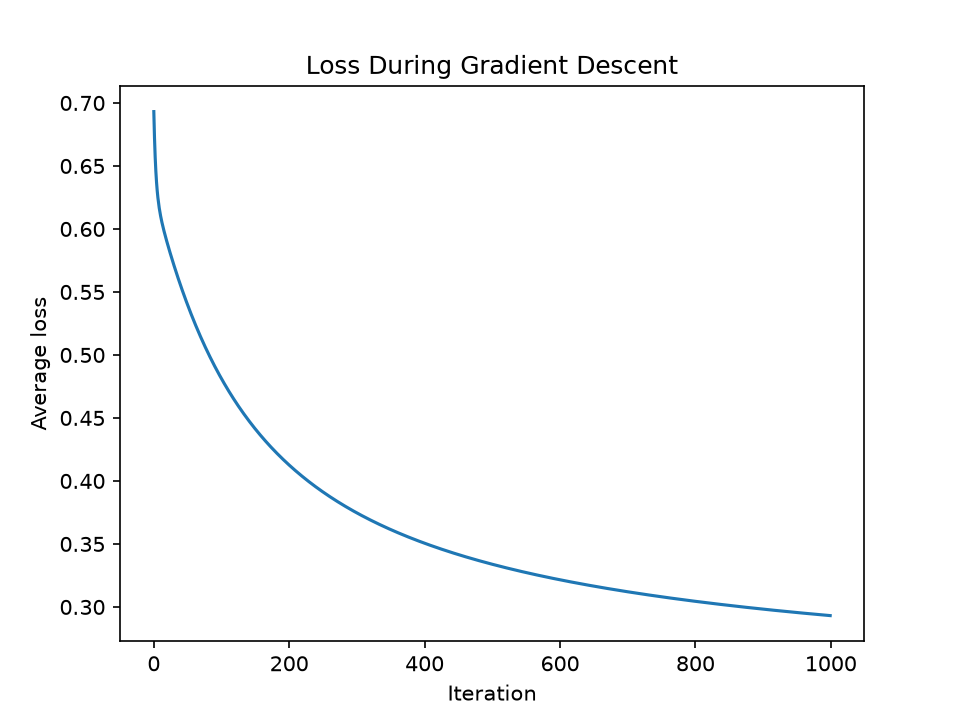
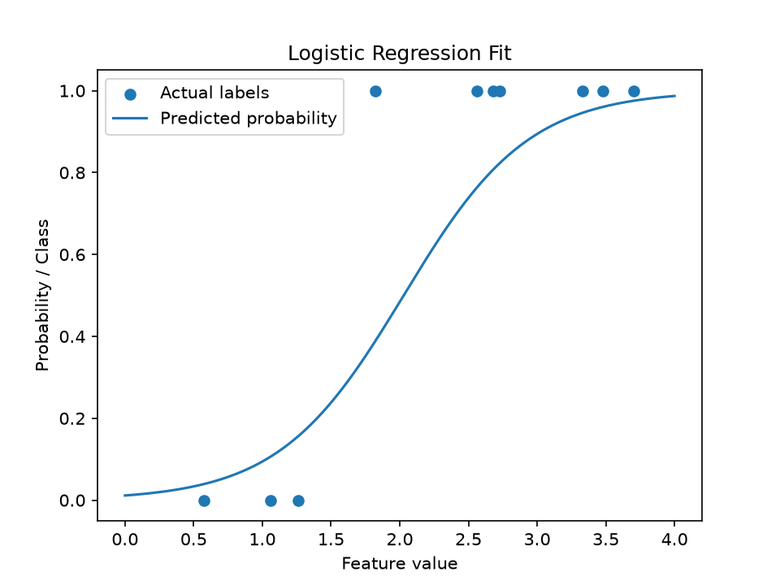

# Logistic Regression Class and Variable Class

A Python implementation of logistic regression that uses gradient descent for training and a custom class (`variable_class.py`) to compute gradients.

**Author:** Ava Cai
**Course:** CSC 561
**Assignment:** Project 2

## Overview

A Python implementation of logistic regression that uses gradient descent for training and a custom class (`variable_class.py`) to compute gradients.

The model performs binary classification, predicting whether an input belongs to class 0 or class 1. Unlike implementations that manually calculate the derivatives of the logistic regression loss function, this model uses a custom implementation of a mathematical expression tree of `Variable` objects to compute gradients.

The implementation follows a similar interface to scikit-learn, with `fit()` for training and `predict()` for making predictions.

## How It Works

### Logistic Regression

Logistic regression is a supervised machine learning algorithm used for binary classification.

For each input example, the model calculates a weighted sum of its features and a bias:

`z = w₀x₀ + w₁x₁ + ... + wₖxₖ + b`

The result is passed through the sigmoid function:

`p = 1 / (1 + e^(-z))`

This produces a probability between 0 and 1. The model predicts class 1 when the probability is greater than or equal to 0.5 and class 0 otherwise.

### Loss Function

The model uses binary cross-entropy to measure the difference between predicted probabilities and actual labels:

`L = -[y log(p) + (1-y) log(1-p)]`

The cost function is the average loss across all training examples.

### Automatic Differentiation

The model uses the custom `Variable` class in `variable_class.py` to calculate gradients.

Each mathematical operation creates a node in an expression tree. These nodes implement `evaluate()` to calculate the expression's numerical value and `grad()` to recursively compute its partial derivatives using differentiation rules such as the sum, product, power, and chain rules.

During training, the logistic regression model builds an expression tree representing the cost function. It then calls `cost.grad(values)` to calculate the gradients with respect to every weight and the bias.

### Gradient Descent

The model uses gradient descent to minimize the cost function.

During each training iteration, the weights and bias are updated according to:

`parameter = parameter - learning_rate * gradient`

This process repeats for the specified number of iterations. The final parameter values are stored and used to make predictions.

## Dependencies

- Python 3
- NumPy
- Matplotlib (for testing and visualization)
- scikit-learn (for evaluation)
- `variable_class.py` (custom class)

## LogisticRegression Class

### Parameters

| Parameter | Default | Description |
|---|---|---|
| `learning_rate` | `0.1` | Controls the size of each gradient descent update. |
| `iterations` | `1000` | Number of gradient descent iterations performed during training. |

### Attributes

| Attribute | Description |
|---|---|
| `w` | NumPy array containing the learned weights, one for each input feature. |
| `b` | Learned bias parameter. |

Both attributes are initialized to `None` and assigned numerical values after training.

### Methods

**`fit(X, y)`**

Trains the logistic regression model using gradient descent.

- `X`: A two-dimensional NumPy array of shape `(n_samples, n_features)` containing the training features.
- `y`: A one-dimensional NumPy array of shape `(n_samples,)` containing binary labels (0 or 1).

The method creates symbolic variables for each weight and the bias, constructs the binary cross-entropy cost function, and uses automatic differentiation to update the parameters.

**`predict(X)`**

Predicts binary class labels using the learned weights and bias.

- `X`: A two-dimensional NumPy array of shape `(n_samples, n_features)` containing input features.

Returns a one-dimensional NumPy array containing predicted labels (0 or 1).

## Usage Example

The following example generates a dataset with one feature and trains the model to classify examples based on whether the feature value is approximately greater than 2.

```python
import numpy as np
from logistic_regression import LogisticRegression

np.random.seed(0)

# Generate 50 examples with one feature
X = np.random.uniform(0, 4, size=(50, 1))

# Generate binary labels with random noise
y = (X[:, 0] + np.random.normal(0, 0.5, 50) > 2).astype(int)

# Train the model
model = LogisticRegression(learning_rate=0.1, iterations=1000)
model.fit(X, y)

# Make predictions
predictions = model.predict(X)

# Evaluate training accuracy
accuracy = np.mean(predictions == y)

print("Weights:", model.w)
print("Bias:", model.b)
print("Training accuracy:", accuracy)
```

## Testing and Evaluation

The implementation is evaluated on previously unseen test data to determine whether it learns the expected relationships and generalizes to new examples.

### Single-Feature Classification

A synthetic dataset of 50 examples is generated with one feature ranging from 0 to 4. Binary labels are assigned using a threshold of approximately 2, with random noise added.

This test evaluates whether the model can learn a simple binary classification relationship.

**Results:** The data was split into 40 training examples and 10 testing examples. After 1000 iterations with a learning rate of 0.1, the model learned:

| Parameter | Value |
|---|---|
| Weight `w_0` | 2.198 |
| Bias `b` | -4.459 |
| Training accuracy | 87.5% (35/40) |
| Test accuracy | 90% (9/10) |

### Multiple-Feature Classification

A separate dataset with multiple input features can be used to verify that the model correctly creates and updates one weight for each feature.

**Results:** A dataset of 100 examples with 3 features (each between 0 and 4) was generated. Labels were assigned as 1 when x_0 + 2x_1 - x_2 (plus noise) > 4. The model was trained on 80 examples and tested on 20.

| Parameter | Value |
|---|---|
| Weight `w_0` | 1.143 |
| Weight `w_1` | 2.862 |
| Weight `w_2` | -2.145 |
| Bias `b` | -3.269 |
| Training accuracy | 97.5% (78/80) |
| Test accuracy | 95% (19/20) |

The model created exactly one weight per feature, which the test verifies with `assert len(model.w) == 3`.

### Gradient Descent Convergence

The average cost can be recorded across training iterations and plotted to determine whether gradient descent successfully reduces the loss.

**Results:**



For the single-feature dataset, the average loss starts at around 0.7. It falls to 0.5 by iteration 100, 0.35 by iteration 500 and 0.3 by iteration 1000. The loss drops quickly at first and then levels off, which shows that gradient descent is reducing the cost. The curve is still decreasing slightly at iteration 1000, so more iterations would most likely lower the loss even more.

### Quality of Fit

For a single-feature dataset, the model's predicted probability curve can be plotted against the actual labels to visually evaluate the fit.

**Results:**



The predicted probability curve has the expected S-shape and crosses 0.5 at about x = 2, which was the classification boundary. Test examples with values about 0.6 to 1.3 are labeled 0 and fall where the predicted probability is low. Examples above about 2.5 are labeled 1 and fall where the predicted probability is high. The one point the model gets wrong where x is around 1.8, sits close to the boundary, where the model is least certain. This is expected given the noise in the labels.

## Assumptions and Limitations

- The implementation supports two classes, represented by 0 and 1. It does not currently support multiclass classification.
- Directly calculating sigmoid probabilities and logarithms may cause numerical errors when probabilities approach 0 or 1.
- The recursive automatic differentiation implementation may repeatedly evaluate parts of the expression tree, making training slower than optimized machine learning libraries.
- Features with very different numerical ranges may affect gradient descent convergence. The implementation does not automatically standardize features.
- Training runs for a specified number of iterations rather than stopping automatically when the cost converges.

## Potential Applications

This model can be used for binary classification tasks where input features are numerical and the relationship can be approximated by a linear decision boundary. Examples include predicting whether a student passes an exam based on study habits or classifying whether a patient is positive for a diagnosis.

## References

- [Scikit-learn: Automatic Relevance Determination Regression Example](https://scikit-learn.org/stable/auto_examples/linear_model/plot_ard.html)
- [Scikit-learn: Linear Models User Guide](https://scikit-learn.org/stable/modules/linear_model.html)
- [Scikit-learn: LogisticRegression API Reference](https://scikit-learn.org/stable/modules/generated/sklearn.linear_model.LogisticRegression.html)
- [Scikit-learn GitHub README](https://github.com/scikit-learn/scikit-learn/blob/main/README.rst)
- [Make a README](https://www.makeareadme.com/)